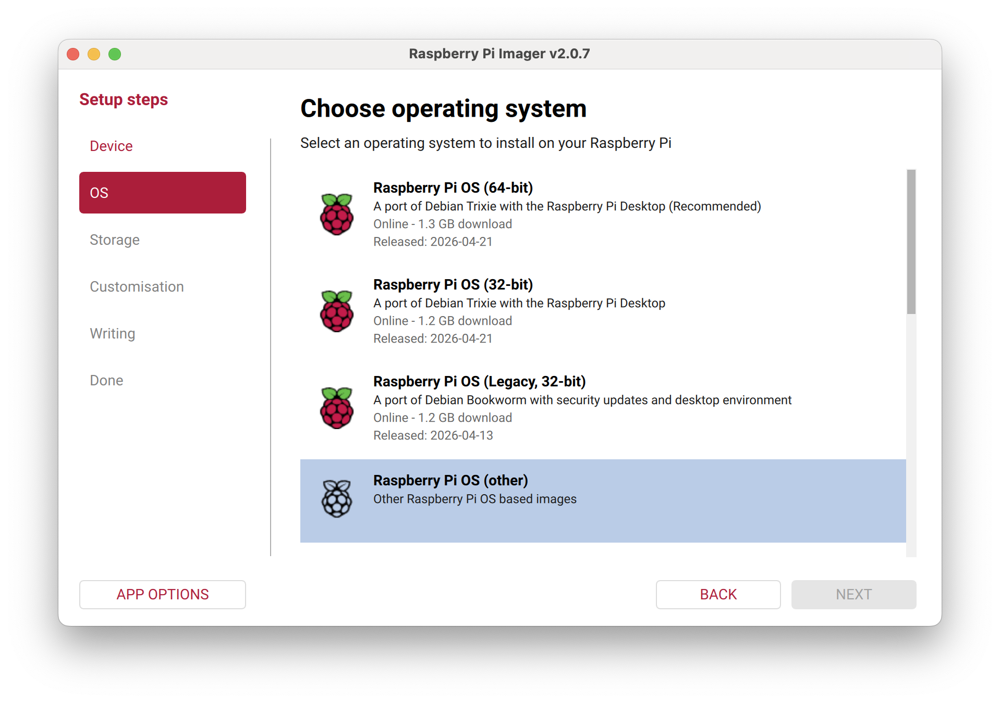
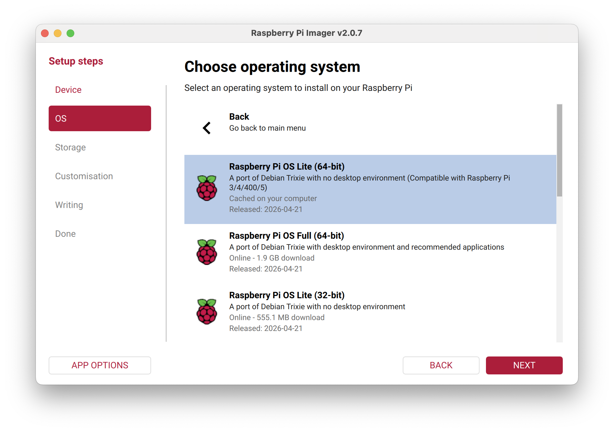
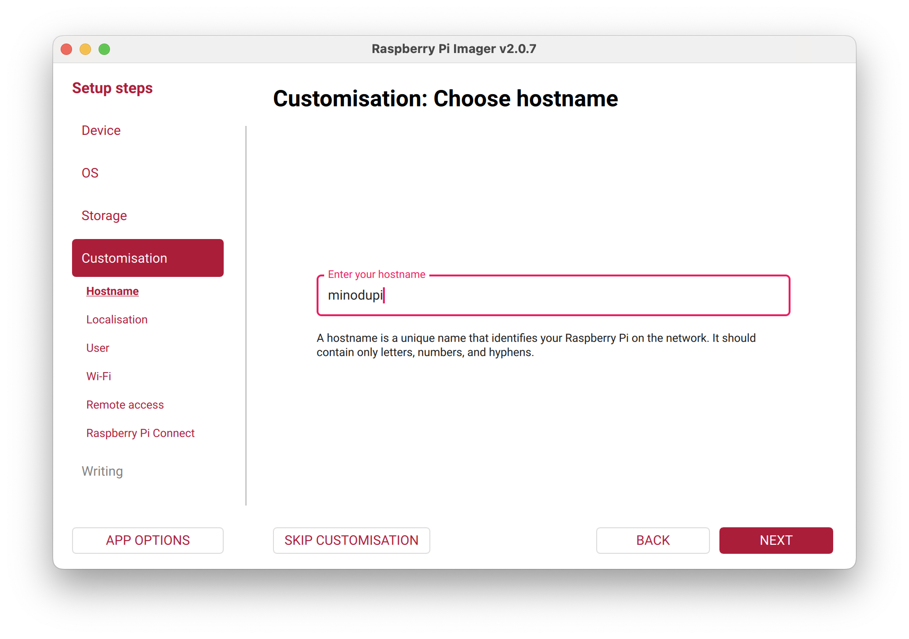
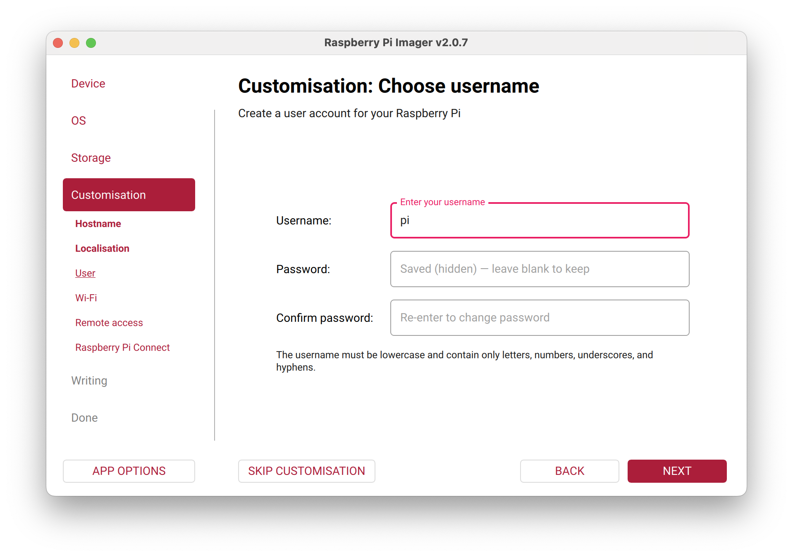
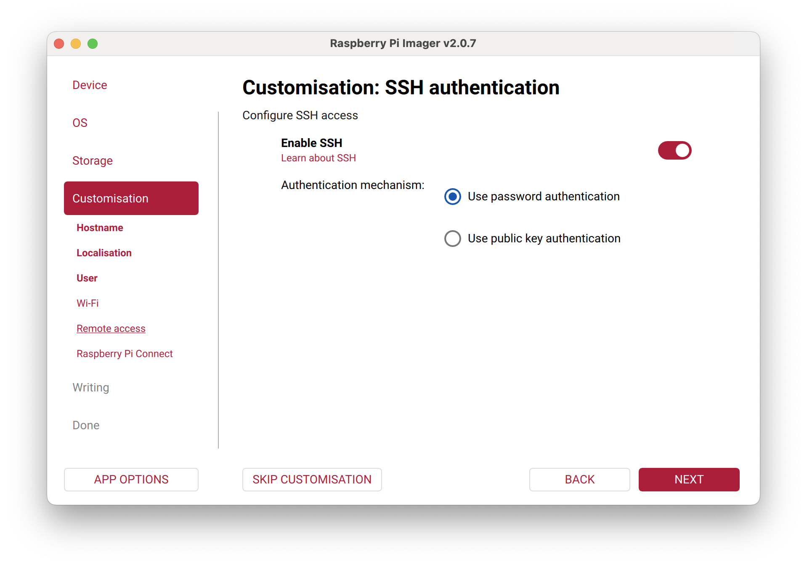

This will guide you through the setup process of the Minodu LCN on the Raspberry Pi.

## Requirements

* A Raspberry pi 4 or 5, preferebly with 8GB of ram.
* An ethernet adapter and a cable
* An SD card reader and an sd card with a minimum size if 64GB.
* Python has to be installed on your computer

## Setup Raspberry Pi Image

### Create Base Image

* Install Raspberry Pi OS Lite (64 bit) on Raspberry Pi. (Tested with this [version](https://downloads.raspberrypi.com/raspios_lite_arm64/images/raspios_lite_arm64-2026-04-21/).) You can use [Raspberry PI Imager](https://www.raspberrypi.com/software/) to create the Image



* Set the hostname to minodupi.local, the username to pi and enable ssh in the custom settings of the image. remember the password you choose and write it down.



* Once the image is written, insert the sd card into the pi

### Connect to RPI

* Connect via ethernet cable to raspberry pi and enable internet Sharing on mac, alternativly, you can plug the raspberry pi into your dhcp router via ethernet
* Make sure `ping minodupi.local` returns an answer, meaning your machine can discover the raspberry pi in the network
* Alternative: Connect Monitor do RPI and type in `ifconfig` to find out the RPIs ip address and use that one instead of *minodupi.local*

## Install MinoduLCN

* Run all of these commands on your host machine. **Don't run these scripts on the raspberry pi itself.**

### For Mac OS users
* Download and unzip the minodu installer from [https://github.com/MinoduLCN/minodu-installer/archive/refs/heads/main.zip](https://github.com/MinoduLCN/minodu-installer/archive/refs/heads/main.zip) or download it with `curl -L https://github.com/MinoduLCN/minodu-installer/archive/refs/heads/main.zip -o repo.zip && unzip repo.zip`
* Open a terminal and run:
  ```
  cd minodu-installer-main
  pip install pyinfra
  # run full install script
  pyinfra @ssh/minodupi.local deploy.py -v --ssh-user="pi" --ssh-password="<pi-user-password>"
  # or using an ip address
  pyinfra @ssh/<ip-address> deploy.py -v --ssh-user="pi" --ssh-password="<pi-user-password>"
  # or run a single step 
  pyinfra @ssh/minodupi.local 01_system_packages.py -v --ssh-user="pi" --ssh-password="<pi-user-password>"
  # alternativly you can run the install script on the raspberry pi itself by logging in via ssh and running:
  pyinfra @local deploy.py
  ```
* It will ask you the following options. In [brackets] is the default value if you leave it empty. Installing the llm is only recommended on a raspberry pi 5 with at least 8gb of ram and a good cooling fan.
  ```
  WiFi SSID [Minodu]:
  WLAN country code [DE]:
  RaspAP admin password [secret]:
  Install Minodu LLM for Chatbot (y/n) [n]:
  Admin phone number [90000000]:
  Admin password [secret]:
  ```
* Follow the instructions and wait until the installer is done, if you select to install the llm the install procedure will take much longer, since it needs to build the vector database on the raspberry pi.
* **The installer might drop the ssh connection after installing the wlan driver and throws an error. If that happens, just wait until it is rebooted and start the script again. It will skip the completed steps**

## Windows Setup Guide

This guide explains how to prepare a Windows computer, install the required tools, configure SSH, connect to the Raspberry Pi, download the Minodu Installer, and run the Minodu deployment.

The installation is designed as a **single sequential process**. Complete the **Prerequisites and Environment Setup** section before downloading or running the Minodu Installer.

---

### 1. Before You Begin

Before starting, make sure you have:

* A Windows PC with PowerShell
* Internet access
* A Raspberry Pi powered on and connected to the same network as your PC
* The Raspberry Pi IP address
* The Raspberry Pi SSH username: "pi" for this setup
* The Raspberry Pi SSH password

#### Example values used in this guide

The examples below use:

```text
Raspberry Pi IP: 192.168.0.30
SSH username:    pi
```

Replace these values with the information for your Raspberry Pi.

---

### 2. Prepare the Windows Environment

Complete **all the steps in this section before downloading the Minodu Installer**.

This ensures that all required tools are already available when the actual installation starts.

---

#### Step 1 - Open PowerShell

Open **Windows PowerShell**.

You can open it by:

1. Pressing `Windows + R`
2. Typing:

```text
powershell
```

3. Pressing **Enter**

For the standard installation, administrator privileges should not be required.

---

#### Step 2 - Install Python

Minodu Installer requires Python.

##### Check whether Python is already installed

Run:

```powershell
python --version
```

If Python is installed, you should see something similar to:

```text
Python 3.x.x
```

If Python is not installed, download it from the official Python website:

https://www.python.org/downloads/windows/

During installation, make sure to enable:

```text
Add python.exe to PATH
```

Then complete the installation.

##### Important

After installing Python, **close PowerShell and open a new PowerShell window**.

This ensures that the updated Windows `PATH` is loaded.

Then verify again:

```powershell
python --version
```

You should now see:

```text
Python 3.x.x
```

Do not continue until this command works.

---

#### Step 3 - Verify Python's package manager

Minodu uses Python's package manager (`pip`) to install `pyinfra`.

Run:

```powershell
python -m pip --version
```

You should see information similar to:

```text
pip XX.X.X from ...
```

If the command works, Python and `pip` are ready.

---

#### Step 4 - Install pyinfra

Install `pyinfra`:

```powershell
python -m pip install pyinfra
```

Wait until the installation is complete.

Then verify the installation:

```powershell
python -m pyinfra --version
```

You should see the installed `pyinfra` version.

##### Important

Use:

```powershell
python -m pyinfra
```

instead of:

```powershell
pyinfra
```

This ensures that Windows uses the `pyinfra` installation associated with the Python installation you just verified.

---

#### Step 5 - Verify SSH

The Minodu Installer uses SSH to communicate with the Raspberry Pi.

Check whether the Windows SSH client is available:

```powershell
ssh -V
```

You should see an OpenSSH version, for example:

```text
OpenSSH_for_Windows_9.x
```

If `ssh` is not recognized, install or enable the Windows **OpenSSH Client** before continuing.

On recent versions of Windows, this can be done through:

**Settings → Apps → Optional Features → View features → OpenSSH Client**

After installing it, close PowerShell, open a new PowerShell window, and run:

```powershell
ssh -V
```

Do not continue until the SSH command is available.

---

### 3. Prepare SSH

Once Python, `pip`, `pyinfra`, and SSH are ready, configure the SSH environment.

#### Step 6 - Create the SSH directory

Run:

```powershell
New-Item -ItemType Directory -Force "$HOME\.ssh"
```

This creates the SSH directory if it does not already exist.

---

#### Step 7 - Create the known_hosts file

Run:

```powershell
New-Item -ItemType File -Force "$HOME\.ssh\known_hosts"
```

The `known_hosts` file stores the SSH host keys of computers you connect to.

---

### 4. Test the Raspberry Pi Connection

Before installing Minodu, make sure that your PC can communicate with the Raspberry Pi.

This is the **only connection test required before deployment**.

#### Step 8 - Connect to the Raspberry Pi

Run:

```powershell
ssh pi@192.168.0.30
```

Replace:

```text
pi
```

with your Raspberry Pi username and:

```text
192.168.0.30
```

with your Raspberry Pi IP address.

##### First SSH connection

If this is the first time you connect to the Raspberry Pi, SSH may display:

```text
Are you sure you want to continue connecting (yes/no/[fingerprint])?
```

Type:

```text
yes
```

Then enter the Raspberry Pi user's password.

If the connection is successful, you should see a shell similar to:

```text
pi@raspberrypi:~ $
```

This confirms that:

* The Raspberry Pi is reachable
* The IP address is correct
* SSH is working
* The username is correct
* The password is correct

Disconnect from the Raspberry Pi:

```bash
exit
```

You can now proceed with the Minodu installation.

---

### 5. Download the Minodu Installer

The Windows environment and SSH connection are now ready.

#### Step 9 - Download the repository

Return to PowerShell on your Windows PC.

Download the latest version of the Minodu Installer:

```powershell
curl.exe -L https://github.com/MinoduLCN/minodu-installer/archive/refs/heads/main.zip -o repo.zip
```

This downloads the repository as:

```text
repo.zip
```

---

#### Step 10 - Extract the repository

Extract the repository:

```powershell
Expand-Archive -Path "repo.zip" -DestinationPath "." -Force
```

This creates:

```text
minodu-installer-main
```

---

#### Step 11 - Open the project directory

Navigate into the Minodu Installer directory:

```powershell
cd minodu-installer-main
```

You are now inside the Minodu Installer project.

---

### 6. Run the Minodu Deployment

All required tools and the SSH connection have already been prepared.

There is no need to go back to the previous steps.

#### Step 12 - Run the deployment

Run:

```powershell
python -m pyinfra "@ssh/192.168.0.30" deploy.py -v --ssh-user="pi" --ssh-password="Password"
```

Replace:

```text
192.168.0.30
```

with the Raspberry Pi IP address,

```text
pi
```

with the Raspberry Pi SSH username, and

```text
Password
```

with the Raspberry Pi SSH password.

For example:

```powershell
python -m pyinfra "@ssh/192.168.0.30" deploy.py -v --ssh-user="pi" --ssh-password="your-password"
```

`pyinfra` will connect to the Raspberry Pi and execute the deployment defined in:

```text
deploy.py
```

---

#### Security Note

Avoid putting a real password directly into a command if the command may be stored in PowerShell history or logs.

For production or repeated deployments, SSH key authentication is preferable.

---

### 7. Complete Installation Sequence

Once Python, SSH, and `pyinfra` have been prepared, the Minodu installation follows this sequence:

```powershell
curl.exe -L https://github.com/MinoduLCN/minodu-installer/archive/refs/heads/main.zip -o repo.zip

Expand-Archive -Path "repo.zip" -DestinationPath "." -Force

cd minodu-installer-main

python -m pyinfra "@ssh/192.168.0.30" deploy.py -v --ssh-user="pi" --ssh-password="Password"
```

The commands above assume that the **Environment Setup** section has already been completed successfully.

---

### 8. Troubleshooting

#### Python is not recognized

If PowerShell displays:

```text
python : The term 'python' is not recognized...
```

Python is either not installed or is not available in the Windows `PATH`.

Install Python and make sure:

```text
Add python.exe to PATH
```

is enabled during installation.

Then:

1. Close PowerShell.
2. Open a new PowerShell window.
3. Run:

```powershell
python --version
```

---

#### pip is not available

Run:

```powershell
python -m pip --version
```

If this command fails, verify that Python was installed correctly before continuing.

---

#### pyinfra is not available

Always use:

```powershell
python -m pyinfra --version
```

and:

```powershell
python -m pyinfra ...
```

instead of calling:

```powershell
pyinfra
```

directly.

---

#### SSH is not recognized

Run:

```powershell
ssh -V
```

If PowerShell reports that `ssh` is not recognized, install or enable the Windows **OpenSSH Client**.

After installation, restart PowerShell and run:

```powershell
ssh -V
```

again.

---

#### SSH cannot connect to the Raspberry Pi

Check the following:

* The Raspberry Pi is powered on.
* The Raspberry Pi is connected to the network.
* The Windows PC and Raspberry Pi are connected to the same network.
* The IP address is correct.
* SSH is enabled on the Raspberry Pi.
* The SSH username is correct.
* The password is correct.

Test the connection with:

```powershell
ssh pi@192.168.0.30
```

Do not run the Minodu deployment until this SSH connection succeeds.

---

#### SSH reports that `known_hosts` does not exist

Create the SSH directory:

```powershell
New-Item -ItemType Directory -Force "$HOME\.ssh"
```

Then create the file:

```powershell
New-Item -ItemType File -Force "$HOME\.ssh\known_hosts"
```

Test the connection again:

```powershell
ssh pi@192.168.0.30
```

---

### 9. Installation Checklist

Before running the Minodu deployment, make sure all of the following are complete:

* [ ] Python is installed
* [ ] `python --version` works
* [ ] `python -m pip --version` works
* [ ] `pyinfra` is installed
* [ ] `python -m pyinfra --version` works
* [ ] SSH is installed
* [ ] `ssh -V` works
* [ ] The `.ssh` directory exists
* [ ] `known_hosts` exists
* [ ] The Raspberry Pi is reachable
* [ ] SSH authentication works
* [ ] The Minodu repository has been downloaded
* [ ] The repository has been extracted
* [ ] The PowerShell terminal is inside `minodu-installer-main`

Once all items are complete, run the deployment command.

---


## Manual installation
If the installation script fails, you can check this repo to guide you through the manual installation process: [https://github.com/MinoduLCN/minodu-installer](https://github.com/MinoduLCN/minodu-installer).
  
## Troubleshooting

* Make sure raspberrpi is reachable with `ping minodupi.local`. If not. reinstall image and make sure to set the hostname to minodupi.local
* make sure there is a user on the raspberry pi with the name *pi* (standard username).
* Make sure ssh is enabled, test with `ssh pi@minodupi.local`. Default password is *raspberry*. If it is not working reinstall image and enable ssh access.
* Make sure your computer is connected to the internet during the install procedure.

